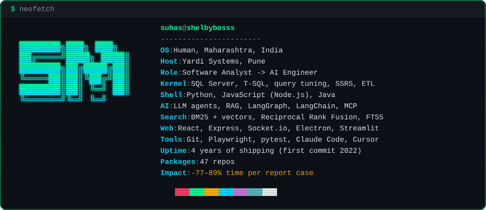

<!--
  > You read README source. Respect.
  > SELECT 'hello' FROM visitors WHERE curiosity > 9000;
  > Say hi: suhasmagar273@gmail.com
-->

<p align="center">
  
</p>

<p align="center">
  
</p>

<p align="center">
  <a href="https://www.linkedin.com/in/suhasmagar"></a>
  <a href="mailto:suhasmagar273@gmail.com"></a>
  <a href="https://www.leetcode.com/suhas77/"></a>
  <a href="https://www.codechef.com/users/shelby7"></a>
  <a href="https://instagram.com/suhas_m1/"></a>
  
</p>

<p align="center">
  
</p>

### `$ cat about.md`

I pushed my first repo in 2022: a library website in plain HTML. By 2024 I'd shipped 30+ side projects. Then I joined Yardi Systems, went deep into SQL Server and real estate reporting, and now I build AI tools on top of it. My favourite trick: **let the model make only the judgement calls, and let code check everything else.**

### `$ neofetch`



### `$ ls -la ~/projects`

| | Project | What it does | Stack |
|:-:|---|---|---|
| 🧠 | **AI report platform** `private` | Turns a plain-English request into a tested SQL report in **15–30 min instead of 2–4 hours**, returning **360–415 developer-hours a month** to my team | Python · Hybrid search · MCP · SQL Server |
| 🎧 | **[SyncBeats](https://github.com/Shelbybosss/SyncBeats)** · [`live`](https://syncbeats-27ay.onrender.com/) | Paste a YouTube link and listen with friends in perfect sync, with a shared queue | Node.js · Socket.io |
| 🔎 | **Support knowledge assistant** `private` | Answers questions from past case-solution emails and cites every email it used. Cut cost per LLM call about **17x** | LangGraph · RAG · Streamlit |
| 📺 | **[NoTube](https://github.com/Shelbybosss/youtube-summarizer-notube)** | Turns a YouTube video into a summary and a mind map | React · Node.js |
| 📱 | **[BinaryB Cast](https://github.com/Shelbybosss/MobileScreenMirroringPC-Control-Application-)** | Mirrors and controls an Android phone from a PC, with **60% lower latency** | Electron · ADB |
| ⏱️ | **[Rate-limited task queue](https://github.com/Shelbybosss/redis-taskqueing)** | Lets each user run 1 task a second and 20 a minute, and queues the rest | Node.js · Redis |

### `$ tail -f now.log`

```diff
+ [building]    AI tools for real estate reporting at Yardi Systems
+ [shipped]     report cases now take 77–89% less time
+ [exploring]   LLM agents, Model Context Protocol, hybrid retrieval
+ [practising]  DSA, one problem at a time
# [side_quest]  SyncBeats: listen to music in sync with friends, anywhere
```

### `$ git log --graph`

<picture>
  <source media="(prefers-color-scheme: dark)" srcset="https://raw.githubusercontent.com/Shelbybosss/Shelbybosss/output/github-snake-dark.svg">
  <source media="(prefers-color-scheme: light)" srcset="https://raw.githubusercontent.com/Shelbybosss/Shelbybosss/output/github-snake.svg">
  
</picture>

<p align="center">
  
</p>

### `$ exit`

```sql
COMMIT;  -- thanks for stopping by. Connection closed.
```
